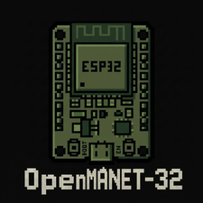

<p align="center"></p>

# openmanet-32

An ESP32-S3 with a Wi-Fi HaLow radio that joins an OpenMANET mesh as
a full meshpoint, encryption included, and offers a 2.4 GHz hotspot so phones and laptops can
reach the mesh through it. It's a small, cheap, low-power node you can leave somewhere to
extend the mesh.

- **802.11s mesh link over HaLow** (`main/mesh.c`): beacons, peering, 4-address data frames,
  HWMP path replies.
- **Mesh encryption** (`main/mesh_sec.c`): SAE, the authenticated peering exchange (AMPE),
  CCMP and protected management frames, as OpenMANET requires.
- **batman-adv, BATMAN_V** (`main/batadv.c`): the routing OpenMANET runs. ELP, OGM2, route
  selection and forwarding, translation table, fragments, `batctl ping` and `traceroute`
  replies. Written from the Linux kernel source.
- **Hotspot and web page** (`main/hotspot.c`): a 2.4 GHz access point with NAT into the mesh,
  a first-boot setup page, and a status and settings page behind a root sign-in, styled in
  OpenMANET's colors.

Nothing about your network is built into the firmware. A freshly flashed board starts in
setup mode and asks for the mesh name and password on its setup page.

**Building one?** Follow the step-by-step guide, [docs/HOWTO.md](docs/HOWTO.md). It covers
parts, reading your mesh settings, installing the toolchain, flashing, setup and
troubleshooting. The rest of this page is the short version.

## Hardware

- Seeed Studio XIAO ESP32S3 (8 MB flash, 8 MB PSRAM), with its 2.4 GHz antenna
- Wio-WM6180 Wi-Fi HaLow Module for XIAO (Seeed 109100041; Quectel FGH100M-H, Morse Micro
  MM6108, 902 to 928 MHz)
- A 900 MHz antenna for the HaLow module. Attach it before powering the board.

Seeed's [Getting Started with Wi-Fi HaLow Module for XIAO](https://wiki.seeedstudio.com/getting_started_with_wifi_halow_module_for_xiao/)
shows how the two boards fit together. The pin map is in `sdkconfig.defaults.esp32s3`. On USB power the HaLow transmit power is capped
at 8 dBm and the hotspot at 11 dBm, because the two radios together can draw more than a USB
port supplies. Raise the HaLow cap on the dashboard (HaLow radio, Transmit power) for a node
with a proper supply.

## Tested with

OpenMANET 24.10 1.8.0 on two Heltec HT-HD01 V2 nodes (Morse driver and chip firmware 2.0.1).
The board peers with both nodes on the encrypted mesh, shows up as a batman-adv neighbour, and
answers pings from them and from devices on their access points, including 1400-byte
packets. It rejoins about 20 seconds after a reset.

## Build and flash

You need [ESP-IDF 5.4.4](https://docs.espressif.com/projects/esp-idf/en/v5.4.4/esp32s3/get-started/).
The Morse Micro HaLow driver (`morsemicro/halow`) is fetched from the Espressif component
registry on the first build.

```bash
. ~/esp/esp-idf/export.sh
idf.py set-target esp32s3
idf.py build
idf.py -p /dev/cu.usbmodemXXXX flash monitor
```

The radio starts on OpenMANET's US defaults. If your mesh uses another channel, pick it on
the setup page or the dashboard (see [Radio settings](#radio-settings) and step 3 of the
[how-to](docs/HOWTO.md#3-read-your-mesh-settings-from-an-openmanet-node)); no rebuild needed.

## First-time setup

1. Power the board. The LED blinks slowly: it is in setup mode, with the HaLow radio off.
2. On a phone, join the open Wi-Fi network `Meshpoint-XXXX-Setup` (the XXXX comes from the
   board's MAC address). The setup page opens by itself; if it doesn't, browse to
   `http://192.168.4.1`.
3. Sign in as user `root` with the default password `openmanet`.
4. Fill in the three steps:
   1. a new root password (it replaces the default);
   2. your OpenMANET mesh name and password, the same as on your nodes (in LuCI, the HaLow
      mesh interface's Mesh ID and key), or tick "This mesh has no password";
   3. the hotspot name and password.
5. Tap **Finish setup**. The board restarts, joins the mesh, and offers your hotspot. The LED
   goes off.

## Day to day

Join the board's hotspot and open `http://192.168.4.1`. Sign in as root with your password
to see:
- the mesh nodes it hears, linked or not, with signal strength;
- the nodes reachable across the mesh;
- its mesh address and HaLow channel;
- the hotspot clients.

From the same page you can change the mesh, HaLow radio and hotspot settings (the board
restarts) or the root password (no restart; everyone is signed out). Changes are only accepted from the
board's own hotspot. Over the mesh, root can sign in and look but not change anything.

Hotspot clients reach the mesh through NAT. The board offers no DNS, since an OpenMANET mesh
has none of its own, so use addresses.

**Locked out or forgot a password?** Hold the BOOT button for 5 seconds while the board runs
(the LED blinks fast). That erases every setting, the root password included, and the board
restarts in setup mode with `root` / `openmanet` again.

Sign-in details:
- The root password is stored only as a salted PBKDF2-SHA256 hash.
- Five wrong passwords in a row lock sign-in for 30 seconds.
- A session ends after 30 idle minutes, on sign-out, or when the board restarts.
- Passwords are never logged and never sent back by the page.

## Radio settings

The dashboard's **HaLow radio** section (and the **Radio settings** box in the setup
wizard) offers the same choices as the HaLow radio settings on an OpenMANET node, from the
same channel table (Morse Micro's, which OpenMANET ships as
`/usr/share/morse-regdb/channels.csv`):
- **Width**: 1, 2, 4 or 8 MHz.
- **Channel**: the country's channels of that width, shown as number and centre frequency,
  for example "28 (916 MHz)". The operating class follows from the channel.
- **Primary width**: auto, 2 MHz or 1 MHz. Auto works it out as OpenMANET does: 2 MHz on 4
  and 8 MHz channels, else 1 MHz.
- **Primary index**: auto, or one of the 1 MHz positions OpenMANET's own page allows. Auto is
  (width - 1) / 2.
- **Beacon interval**: OpenMANET's mesh default is 1000 TU.
- **Transmit power**: driver default (the regulatory maximum) or a cap from 1 to 30 dBm.

The hotspot section also picks the 2.4 GHz hotspot channel. Saving restarts the board.
Every node in a mesh must use the same channel and primary settings. If you pick a wrong
one, the board drops off the mesh but its hotspot still works, so you can fix it from the
page (or hold BOOT for 5 seconds to start over).

The values a freshly flashed board starts with are build options in `sdkconfig.openmanet`:
channel 28 (916 MHz, 8 MHz wide), primary width and index on auto (2 MHz at index 3), 1000 TU
beacons, an 8 dBm cap. `idf.py menuconfig` under "openmanet-32" also has:
- the default hotspot channel (6) and the hotspot address (192.168.4.1);
- the default root password;
- the reset button and LED pins;
- the bat0 subnet. The board takes `10.41.250.<last byte of its batman address>` on a /16.

The country code stays a build setting: `CONFIG_HALOW_COUNTRY_CODE` (US) in
`sdkconfig.defaults`. It decides which channels and power levels the page offers. Use the
one for where you operate.

## Notes for anyone reading the code

Interop with OpenMANET's Linux side (Morse Micro's hostap and kernel driver) depended on a few
things the standards don't tell you. They are all documented in the comments of
`main/mesh_sec.c` and `main/mesh.c`:

- **SAE method:** Morse's mesh SAE uses hunting-and-pecking even when `sae_pwe=1` is set,
  because the mesh never passes that setting down.
- **AMPE MIC:** the MIC covers 6 bytes of the frame as Morse's driver hands it to
  wpa_supplicant, not as sent on air. For a peering Open that is category, action,
  capability, then the driver's fixed `01 08` Supported Rates stub. The driver also uses a
  fixed AMPE block size, so peering Close frames can never be authenticated.
- **CCMP nonce:** the MM6108 builds it from the transmit metadata's TID, not from the
  frame's QoS header, so the two must agree.
- **PMF:** with protected management frames required, HWMP path requests arrive protected,
  and path replies must be protected too, or unicast never works.

## Documentation

- [docs/HOWTO.md](docs/HOWTO.md): the step-by-step build and setup guide, with
  troubleshooting.
- [docs/batman-adv-on-esp32.md](docs/batman-adv-on-esp32.md): the research notes behind the
  batman-adv implementation.
- [docs/openmanet-test-mesh.sh](docs/openmanet-test-mesh.sh) and its undo script: move an
  OpenMANET node to an open test mesh, to tell radio problems from encryption problems.

## Status and known gaps

- Relaying traffic *through* this board between two nodes that can't hear each other is not
  tested yet. So far every node has been in range of every other.
- Peering Close frames are accepted without authentication (see above).
- If the board restarts within a minute of peering, an OpenMANET node can ignore its new
  handshake for several minutes (seen once, both nodes at the same time; the log shows
  `SAE with ... failed: no answer`). Restarting the board again cleared it.
- No group management key (IGTK) is sent, and broadcast integrity (BIP) is not checked.
- The board pings every batman-adv node it learns about at `10.41.250.<last byte>` and logs
  the result. That only works for other openmanet-32 boards, so the log shows failed pings
  for OpenMANET nodes. It's harmless, and `HOP_PING_PEERS` turns it off.
- Internally the code still uses its working name, hopnode (`hop_main.c`, `HOP_*` options).

## History

This started as the hop node in a set of ESP32 HaLow mesh experiments (HalowChat), and the
git history here is that folder's history.

## License

0BSD or GPL-3.0-or-later, your choice: see `LICENSES/0BSD.txt` and `LICENSE`. The Morse Micro
HaLow driver fetched at build time comes under its own license.
